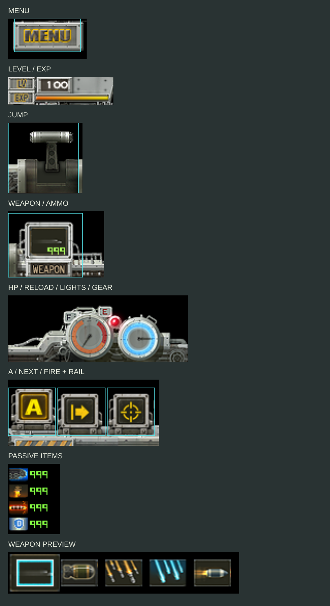
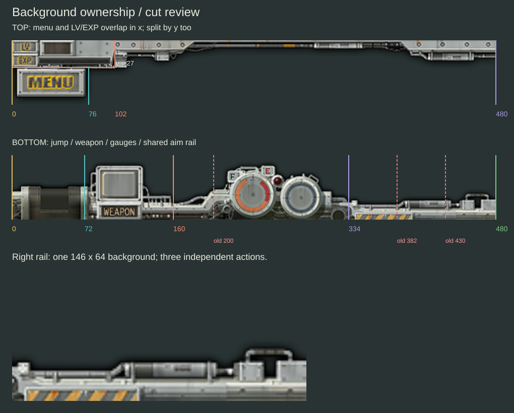
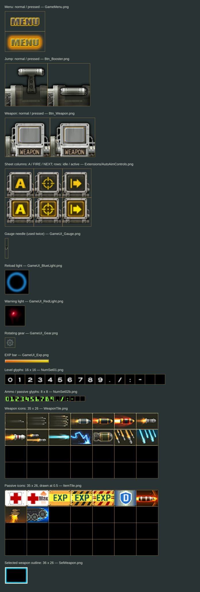

# HUD 배치 편집

**일시정지 메뉴의 ‘SET GAME UI’와 미션 선택 화면의 ‘HUD 배치’에서 버튼과 계기판을 옮길 수 있다.** 자동조준 상태 안내(HM-AIM-VIS)는 [별도 과제](auto-aim-visibility-plan-20261028.md)로 분리했다. 기존 A·표적 전환·사격 버튼의 위치 편집은 HUD 작업에 포함한다.

v0.13은 [main 릴리스](https://github.com/gelb2/HeavyMach/releases/tag/v0.13)에 있다. HUD 작업은 develop에서 분기한 `feat/hud-layout-editor`에서 시작했다. 공용 좌표 계산, HUD 분할·끝마감, 드래그 편집, 터치 연결과 설정 저장을 구현했다. 이 기능은 아직 develop/main에 병합하지 않았다.

## 편집 도구 디자인 변경 계획

2026-10-29 직접 사용한 결과, HUD를 옮기고 옮긴 버튼을 누르는 동작에는 문제가 보이지 않았다는 확인을 받았다. 다음 변경은 편집 도구의 표시·배치와 상단 장식 보존이다. 아래 내용은 구현 전 계획이다.

### 편집 표시와 버튼

노란 선택 사각형과 청록색 터치 영역 사각형을 일반 편집 화면에서 없앤다. 선택한 묶음은 오른쪽 패널에 영문 이름으로 표시한다. 터치 경계선은 개발 검사에서만 사용한다.

오른쪽 안전 영역 안에 세로 도구 패널을 둔다. 게임 화면은 현재 크기와 좌표를 유지한다. 도구 때문에 게임 미리보기를 축소하면 실제 전투의 HUD 위치와 비교하기 어려워진다.

| 표시 | 동작 |
| --- | --- |
| HUD LAYOUT | 편집 패널 제목 |
| PREVIEW | 도구를 접고 현재 배치를 확인 |
| SAMPLE SCENE / CURRENT SCENE | 예시 전투와 멈춘 전투 사이 전환. 실제 전투에서 연 경우에 표시 |
| RESET LAYOUT | 초안을 기본 배치로 되돌림 |
| CANCEL | 변경을 버리고 편집 종료 |
| APPLY | 배치를 저장하고 편집 종료 |
| TOOLS | 오른쪽 가장자리에서 패널 접기·열기 |

기존 ‘도구 위치’와 ‘터치 영역’ 버튼은 일반 편집 도구에서 뺀다. 미션 선택의 ‘HUD 배치’도 `SET GAME UI`로 통일한다. 도움말·선택 묶음 이름·적용 실패 문구도 영문으로 고친다. 안내는 `Drag to move.`처럼 실제 행동을 짧게 적는다.

패널 뒤의 HUD는 먼저 `TOOLS`로 패널을 접고 잡는다. 드래그를 시작하면 펼쳐진 패널도 접어 오른쪽까지 옮길 수 있게 한다. 이동 후 패널을 다시 여는 동작은 `TOOLS`에만 둔다. HUD를 놓는 순간 도구가 튀어나와 다음 조작을 막지 않게 한다. 패널이 접혀도 편집 초안과 선택은 유지한다.

버튼 터치 영역은 최소44pt 높이를 확보한다. 폭은 영문 길이와 iPhone 가로 화면에서 결정한다. 높이가 작은 화면에서는 보조 도구를 스크롤하고 `CANCEL`·`APPLY`는 하단에 유지한다. 패널·접기 탭의 입력과 HUD 드래그 입력을 구분한다.

### 원작 버튼과 같은 재질

`Common_Btn_OK.png`와 `SelMode_Btn_Scenario.png`의 낡은 금속판·리벳·어두운 홈·금색 테두리 글자를 기준으로 만든다. 지금의 회색 둥근 시스템 버튼을 이 형태로 교체한다. 일반·눌림 두 상태도 원작처럼 밝기와 판의 깊이 차이로 표현한다.

원본 버튼 그림을 통째로 늘리지 않는다. 모서리와 리벳은 크기를 유지하고 가운데 판만 이어 붙인다. 필요한 영문은 같은 좁은 대문자 형태로 별도 라벨을 만든다. 기존 메뉴 글자 시트에 없는 글자까지 있다고 가정하지 않고 필요한 글자 목록을 먼저 대조한다. 라벨과 판은 로드할 때 준비하고 드래그 중 매 프레임 이미지를 만들지 않는다.

### 상단 장식 보존

현재 코드는 기본 배치에서 `GameUI_Top.png` 전체를 그린다. 배치를 바꾸면 레벨 표시와 MENU에 속한 부분만 그리고 나머지 금속판·연결 레일을 생략한다. 장식 삭제는 요청에 없었으며, 이 처리로 사용자 배치에서 원작 상단 그림 일부가 사라진다.

생략했던 영역을 원본에서 다시 분리해 독립된 장식 묶음으로 옮길 수 있게 한다. 투명 여백을 제외한 실제 금속판·레일의 연결 상태를 보고 분할한다. 레벨·MENU 받침과 같은 픽셀을 중복으로 넣지 않는다. 장식은 편집 중에만 잡을 수 있고, 실제 전투에서는 터치를 가로채지 않는다. 기존에 저장한 배치는 기능 묶음의 위치를 그대로 읽고, 새 장식의 초기 위치를 추가한다. `RESET LAYOUT`은 원작 상단 전체를 복원한다.

### 구현과 확인 순서

1. 상단 원본 영역과 현재 생략 영역을 나란히 표시하고, 장식까지 합친 재조립 그림을 원본과 픽셀 대조한다.
2. 오른쪽 패널·영문 버튼의 일반/눌림 시안을 게임 미리보기 위에 올린다. 폰·패드·Mac의 작은 창에서 글자와 터치 영역을 확인한다.
3. 장식 이동·패널 접기·영문 표시를 구현한다. 기존 HUD 묶음의 이동·버튼 판정·계기판 갱신을 유지한다.
4. 오른쪽 끝으로 MENU·무기·계기판을 옮긴다. 패널이 열린 상태와 접힌 상태에서 선택·이동·적용·취소·기본 복원·재실행을 검사한다.
5. 장식을 눌러도 전투 사격이 막히지 않는지, 편집 중에는 전투가 멈추는지 확인한다. 사각형을 지워도 키보드 선택과 이동을 구분할 수 있는지 확인한다.

## 실제 iPhone 설치와 조작 검사

2026-10-29 iPhone Air·iOS27.0.1에 일반·치트 앱을 무선으로 설치했다. 자동 검사10개가 모두 통과했다. HUD 편집7개, 전체20종 무기의 수동 사격, 전체20종의 자동조준 이동·점프·사격, 타이머·전체 화면 좌표를 검사했다.

일반 앱에서 계기판 두 개를 함께 위로 옮겼다. 적용 후 다시 열어 저장한 위치를 확인했고, 전투에도 반영됐다. 일시정지 중에는 현재 전투 위에서 편집 화면을 열었다.

치트 앱에서는 이동·점프·터치 사격을 직접 조작했다. 전투를 멈추고 무기 버튼을 오른쪽으로 옮긴 뒤 적용했다.

전투를 재개하고 새 위치를 누르자 RaderBomb으로 바뀌었다. 무기 그림과 탄약10을 확인했다. 검사 후 두 앱의 HUD를 기본 배치로 돌려놓았다.

설치 전후 일반 앱의 진행 저장은 같았다. 직접 전투에 들어간 뒤에는 마지막 접속 시간만 바뀌었다. [기기 검사 기록](../evidence/hud-editor-20261029.json).

## 원작 버튼에 맞춘 멈춤 메뉴

‘RESUME GAME’ 바로 아래에 **SET GAME UI**를 배치했다. 순서는 전투 재개, HUD 배치, 저장 후 나가기, 원작 사이트 방문이다. 네 버튼은 같은 크기와 간격으로 표시되고, 기존처럼 왼쪽에서 순서대로 들어온다.

새 버튼의 글자·검은 반투명 바탕·눌렀을 때의 색은 기존 `GameMenuSub.png`에서 가져왔다. 원작 파일은 그대로 두고 필요한 영역을 게임 렌더러에서 조합한다. 멈춤 메뉴에 따로 뜨던 시스템 버튼은 제거했다.

편집을 적용하거나 취소하면 멈춤 메뉴로 돌아온다. **RESUME GAME**을 눌러야 전투가 재개된다. 아이폰 추가 검사3개가 통과했다. 새 메뉴의 터치·키보드 진입, 편집 중 전투 정지·진행 저장 보존, HUD 이동·저장·계기판 동작을 확인했다.

## 실제 iPad 설치와 조작 검사

2026-10-29 iPad Air 13형 M2·iPadOS27.0.1에 일반 앱과 치트 앱을 무선으로 업데이트 설치했다. 두 앱 모두 현재 HUD 편집 기능을 포함한다.

일반 앱의 미션 선택 화면에서 계기판 두 개를 함께 끌어 올렸다. 금속 받침·바늘·등·기어가 함께 움직인다. 적용 후 다시 열어 같은 위치를 확인했고, 전투에서도 옮긴 위치에 표시됐다. 전투 일시정지 메뉴에서도 편집 화면을 열었다.

치트 앱에서는 전투를 멈추고 무기 버튼을 오른쪽으로 옮겼다.

적용하고 전투를 재개한 뒤 새 위치를 누르자 기본 기관총에서 포탄으로 바뀌었다. 아래 화면의 무기 그림과 탄약10이 그 결과다. 검사가 끝난 뒤 두 앱 모두 기본 HUD 배치로 복원했다.

실제 iPad의 자동 검사10개가 모두 통과했다. 편집7개, 전체20종 무기의 수동 사격, 전체20종의 자동조준 이동·점프·사격, 타이머·전체 화면 좌표 검사다. 편집 검사에는 저장 실패 후 재시도, 버튼 겹침, 크기 변경, 기본 복원과 새 위치의 입력도 포함한다.

계기판 검사는 직접 드래그·적용한 뒤 체력 표시값을 바꾸고 실제 입력 경로로 사격했다. 체력 바늘이 갱신됐고, 발사 지연 계기 값의 변화 폭은0.972였다. 편집 중120프레임에는 바늘·기어·발사 지연 값이 멈췄다. 다음 그림은 이 검사에서 저장한 iPad의 GL 출력이다.

일반 앱의 진행 저장은 설치 전후 해시가 같았다. 직접 전투에 들어간 뒤에는 마지막 접속 시간만 바뀌었다. 게임 저장과 HUD 배치 파일은 별개다. [설치·검사·원시 로그 해시](../evidence/hud-editor-20261029.json).

장시간 발열과 기존 Mac 프레임 처리시간 조사는 남아 있다.

## 편집 구현과 시뮬레이터 검사

미션 선택 화면의 **HUD 배치**, 전투 일시정지 메뉴의 **SET GAME UI**에서 편집한다. 버튼·받침·숫자를 한 묶음으로 끌어 옮기면 실제 전투의 터치 위치도 함께 바뀐다. 기본 배치, 취소, 적용과 편집 표시를 숨기는 화면 확인을 제공한다. 도구 모음은 위아래로 옮길 수 있다.

### iPad에서 직접 옮긴 화면

시작 전 편집은 탱크·지형·지상 적·헬기가 함께 나오는 예시 전투로 열린다. 노란 선은 선택한 묶음이고 청록색 선은 실제 터치 영역이다.

무기 버튼을 오른쪽으로 끌어 옮겼다. 무기 테두리·탄약·금속 받침과 입력 영역이 함께 이동하고, 원래 자리의 버튼은 사라졌다.

‘화면 확인’을 누르면 편집 선과 도구 모음이 사라진다. 다음 터치를 마치면 편집 화면으로 돌아온다. 이 화면의 전투는 정지해 있다.

이 배치를 적용한 뒤 다시 열어 위치가 유지되는 것을 확인했다. ‘기본 배치’를 누른 뒤 취소하면 저장한 오른쪽 배치가 남았고, 기본 배치를 적용한 뒤에는 원래 아래쪽으로 돌아왔다.

편집 중에는 비활성 패시브도 아이콘과 예시 숫자999로 표시한다. 평소 화면에 숨겨진 표시도 위치를 확인해 옮길 수 있다.

### 게임 상태와 저장

편집 중에는 현재 전투의 마지막 그림 목록을 사용한다. 게임 시간·위치·난수·저장 슬롯을 진행시키지 않는다. 예시 전투는 별도 슬롯과 난수를 사용한다. 드래그와 취소의 설정 저장은0회, 변경 배치 적용은1회다. 파일을 저장하지 못하면 편집 화면에서 다시 적용할 수 있다.

창을 줄여 버튼이 겹치면 전투 화면은 기본 배치로 표시한다. 저장한 위치는 남겨 두고 창을 다시 넓히면 복원한다. 편집 화면에서는 겹친 배치의 적용을 막는다.

### 검사 중 고친 문제

- 무기 버튼에서 시작한 터치가 다른 버튼 위에서 끝나며 그 버튼을 실행하는 문제를 수정했다. 처음 누른 버튼이 해제까지 입력을 맡는다.
- 편집 중 검증 패널이 실제 미션을 바꾸지 못하게 막았다.
- 시작 전 편집에서 치트 방향키가 사라지는 문제와 도구 모음에 가려지는 문제를 수정했다.
- 기본 점프 버튼을 선택만 해도 이동한 것으로 기록되는 문제를 수정했다.
- 치트 방향키의 실제 크기와 편집 영역을 통일하고, 키보드 이동도 즉시 반영했다. 기본 위치의 치트 버튼 위로 다른 버튼을 옮기는 경우도 적용을 막는다.
- 예시 전투의 생성 좌표와 카메라 높이를 조정해 탱크·지상 적·헬기가 HUD 위에 보이게 했다.

### 자동 검사 결과

| 환경 | 확인한 내용 | 결과 |
|---|---|---|
| iPad Pro13 M5 시뮬레이터·iOS26.5 | 편집6종: 드래그·새/옛 위치 입력, 메뉴·점프·자동 모드, 저장·취소·복원, 예시 전투, 크기 변경·실패 복구, 치트 입력·반복 진입 | 통과 |
| iPhone Air 시뮬레이터·iOS26.5 | 편집5종: 이동·저장, 예시 전투, 겹침·크기 변경·저장 실패, 터치 소유권·사격 해제, 치트 배치·10회 진입/종료 | 통과 |
| Mac mini·arm64 | 같은 편집6종 | 통과 |
| 공용 좌표 검사 | 기본/사용자 위치, 안전영역·축소·화면 크기 복원, 잘못된 값 | 통과 |
| iPad 무기 검사 | 20종씩 수동 키보드 사격, 자동 모드 이동·점프·사격 | 통과 |
| 기본 HUD 그림 | 앞선 부품 검사와 같은 장면 대조 | 다른 픽셀0개 |
| 빌드 | iOS 시뮬레이터 arm64와 native Mac의 일반·치트 앱 | 성공 |

Mac에서는 별도로 실제 타이머와 창 표시를 측정했다. HUD 수정 전 `9e7b15c3`도 같은 조건으로 빌드했다. 준비30프레임 뒤180프레임의 처리 p95는 다음과 같다.

| 창·장면 | 수정 전 | HUD 편집 추가 후 |
|---|---:|---:|
| 1200×800·타이틀 | 15.916ms | 15.507ms |
| 1200×800·슬롯 | 16.712ms | 18.676ms |
| 1200×800·사격 | 19.215ms | 19.036ms |
| 화면 크기·타이틀 | 19.229ms | 17.867ms |
| 화면 크기·슬롯 | 19.026ms | 14.498ms |
| 화면 크기·사격 | 16.933ms | 15.451ms |

**Mac 성능 검사는 미통과다.** 기준16.67ms를 넘은 조건이 수정 전5개, 수정 후3개였다. 두 실행 모두 시뮬레이터를 종료했고 다른 빌드·화면 조작을 병행하지 않았다. 이번에는 로컬 ad-hoc 서명을 사용했다. 이전 개발 서명 검사와 조건을 맞춘 재측정과 창 표시 지연 조사가 남았다. 객체 해제24항목과 사격 중 게임 저장0회는 두 버전 모두 확인했다.

전투 편집 화면을180회 그리는 동안 새 이미지 디코딩과 진행 저장 변화는 없었다. 실제 iPad HUD 설치·조작 검사는 위 절에 추가했다. iPhone 실물 검사도 위 절에 추가했다. 장시간 발열 검사는 남았다. [검사·로그 해시](../evidence/hud-editor-20261029.json).

## HUD 부품과 분할 검사

실제 앱의 `HMGameHUD.draw`와 `drawAimControls`가 제출한 그림을 기록하고, 런타임 로더로 읽은 16개 이미지와 대조했다. 메뉴·점프·무기·사격·표적 전환의 눌림, 수동/자동 모드, 레벨100·탄약999·패시브999, 무기 목록·재장전등을 검사 장면으로 만들었다.

### 어떤 버튼에 어떤 그림이 붙는가

| 이동 묶음 | 함께 가져갈 그림 | 버튼 판정·주의점 |
|---|---|---|
| 메뉴 | 상단 MENU 받침 + GameMenu의 일반/눌림 글자 | ID100, 64×32. 시트 전체64×64를 한 버튼으로 자르면 두 상태가 붙어 나옴 |
| 레벨·경험치 | LV/EXP 판 + GameUI_Exp + NumSet01 숫자 | 입력 없음. 레벨100의 세 자리와 경험치 바0~100% 포함 |
| 점프 | 하단 왼쪽 받침 + Btn_Booster의 일반/눌림 레버 | ID1000, 68×68. 가로2프레임 시트 |
| 무기 | 무기 받침 + Btn_Weapon의 일반/눌림 테두리 + WeaponTile + 탄약 숫자 | ID1100, 72×62. 버튼 왼쪽은 x67, 받침 분할선은 x72 |
| 계기판 | 원형 테두리2개 + 바늘2개 + 빨간 경고등 + 파란 재장전등 + 회전 기어 | 입력 없음. 빛은 더하기 합성, 바늘·기어는 회전 |
| 자동조준 조작부 | A·표적 전환·사격 버튼 + 오른쪽 공통 받침 | 판정은 각각46×46. 공통 받침을 보존해 한 묶음으로 옮기는 안 |
| 패시브 | ItemTile 아이콘4개 + 각 숫자 | 입력 없음. 아이콘은35×26 타일을 절반 크기로 표시 |
| 무기 선택 미리보기 | 최대5개 무기 그림 + SelWeapon 선택 테두리 | 입력 없음. 선택 무기는1.4배 확대 |
| 치트 방향키 | ←·정지·→·기울기 네이티브 버튼 | PNG 분할 대상이 아님. 뷰와 판정 영역을 함께 이동 |

자동조준 시트의 열 순서는 **A·사격·표적 전환**이고, 화면 배치는 **A·표적 전환·사격**이다. 시트의 왼쪽부터 화면에 붙이면 두 버튼의 기능이 뒤바뀐다. 실제 제출된 타일 번호와 위치를 함께 기록했다.

### 실제 렌더러로 나눠 본 묶음

청록색 선은 버튼의 입력 영역이다. 숫자·무기 그림·빛·회전 부품은 해당 묶음과 함께 그렸다. 이 그림은 끝마감을 붙이기 전 분할 검사다.

### 앞선 분할안에서 고친 부분

1. **무기 버튼 왼쪽5칸:** 배경은 x72부터지만 버튼은 x67부터다. 무기 묶음의 전체 범위를 x67부터 잡는다. 배경 분할 사각형으로 버튼까지 자르지 않는다.
2. **비스듬한 지지대:** x200에서 자르면 계기판 왼쪽 지지대를 가른다. 분할선을 x160의 곧은 레일로 옮겨 지지대를 계기판에 포함했다. 무기 배경은72~160, 계기판 배경은160~334다.
3. **자동조준 공통 받침:** x382·430의 세 등분선은 이어진 파이프와 경고 줄무늬를 나눈다. 오른쪽334~480을 한 장으로 보존하는 안으로 바꿨다. 세 버튼의 입력은 각각 유지한다. 개별 이동을 제공하려면 각 버튼의 완결된 받침을 먼저 추가한다.
4. **계기판 기어:** 기어 중심은(324,3)이다. 원래 화면에서는 아래쪽 일부가 가려진다. 묶음을 화면 가운데로 옮겼다고 그 부분이 새로 드러나지 않도록 기존 바닥선을 묶음 내부의 잘림 기준으로 유지한다.
5. **상단 나머지 장식:** 레벨·메뉴 바깥의 금속 레일도 별도 항목으로 기록했다. 이때 기본 배치에서는 모두 재조립하고, 사용자 배치에서는 연결할 묶음이 없는 레일을 숨기도록 구현했다. 10월29일 사용자 확인 후, 위 계획에 장식 보존·이동 작업을 추가했다.
6. **겹친 그림·빛:** 상하 배경에도 MENU·무기 틀이 있고, 별도 버튼 시트가 그 위에 겹쳐진다. 하나만 옮기면 옛 자리에 틀이 남는다. 경고등·숫자·선택 테두리는 기존 더하기 합성을 유지한다.

**이동 단위는 전투 HUD8묶음과 치트 방향키1묶음이다.** 앞선 안에서는 자동조준3버튼을 각각 옮기도록 했지만, 현재 그림으로는 하나의 받침을 공유한다. 우선 공통 받침과 함께 옮기고, 개별 이동용 받침은 별도 아트 작업으로 둔다.

### 원본 시트의 상태 구분

아래에는 실제 로더가 읽은 버튼·글자·무기 시트를 표시했다. 노란 선은 프레임 경계다. 일반 상태만 잘라 두면 버튼을 누를 때 옆 프레임이나 빈 영역을 읽게 되므로 두 상태를 같이 관리한다.

16개 자원 중 버튼·글자·무기·효과 시트 보기

### 재조립 검사

같은 텍스처를 분할 영역별로 그린 뒤 기존 HUD와 비교했다. 수정한 상단4영역·하단4영역의 재조립은 **480×320 화면에서 다른 픽셀0개**였다. 배경을 원래 자리에 다시 그리는 검사는 통과했다.

| 기존 HUD | 수정한 영역별 재조립 |
|---|---|
|  |  |

첫 하단6영역 검사에서는 x334~381, 화면 아래19행 범위에744픽셀 차이가 발생했다. 이 결과와 검사 로그는 보존했다. 오른쪽 받침을146폭으로 유지한 현재 검사에서는 재발하지 않았다. 세 등분 경로에서 해당 영역이 누락된 원인은 아직 확정하지 않았다.

처음6영역으로 나눴을 때 빠진 받침 보기

버튼 일반/눌림과 부가 표시10상태, 묶음별 출력8상태를 iPad 시뮬레이터에서 확인했다. [부품·좌표·해시 목록](media/hud-audit/audit.json)과 [실제 그리기 목록](media/hud-audit/HUD_draw_inventory.json)을 함께 보관한다.

### 레일 끝마감

사용자 배치에서는 원본 상단 금속판의 왼쪽 끝4픽셀을 재사용해 분할 레일 양 끝에 붙였다. 원본 PNG는 수정하지 않았다. 기본 배치는 기존 전체 그림을 사용한다.

## 현재 화면과 코드

2026-10-27 플레이 녹화. 편집 중에도 이와 같이 전투 장면을 크게 유지한다.

| 확인한 코드 | 확인한 동작 | 설계에 반영할 내용 |
|---|---|---|
| HMGameHUD의 draw | 상하480×64 그림에 무기 테두리·계기판·레일이 합쳐져 있다 | 장식과 기능을 함께 분할 |
| HMGameHUD의 buttonImage | 실제 버튼 타일 크기로 입력 사각형을 만든다 | 그림과 입력에 같은 묶음 변환 사용 |
| HMGameView의 routePoint | 원작 버튼은 중앙480×320 영역 안에서만 검사한다 | 사용자 배치에서는 안전영역 전체에서 검사 |
| aimControlRect | 자동조준3버튼의 그림·입력 사각형이 이미 같다 | 공용 배치 모듈의 소비자로 옮김 |
| HMValidationControls | 치트 방향키는 GPU 그림과 별개인 네이티브 뷰이며 자체 frame으로 배치된다 | 공용 논리 좌표를 UIKit/AppKit 좌표로 변환하고 편집 중 원래 입력을 차단 |
| GameSession의 renderItems | 마지막 전투 프레임의 그림·궤적 목록을 보관한다 | 편집 중 같은 목록을 재사용 |
| GameSession의 collect | 탄환 연기·궤적 등 일부 시각 상태도 갱신한다 | 드래그 때 collect를 재호출하지 않음 |
| HMGameView의 advanceOriginalFrame | 정지 메뉴에서도 화면 시간·카메라 흔들림·HUD 애니메이션 일부가 진행된다 | HUD 편집 상태는 이 갱신보다 먼저 분기 |
| HMGameView의 startSlot | 실제 저장 슬롯·패시브·공유 난수로 세션을 시작한다 | 예시 장면을 만들 때 실제 startSlot을 호출하지 않음 |

메뉴·업그레이드·클리어 화면은 HUD와 같은 클래스 안에 있다. 자유 배치를 클래스 전체에 걸면 이 화면들까지 움직일 수 있다. 전투 HUD를 그리는 구간에만 묶음 변환을 적용한다.

## 이동할 묶음과 그림 분할

처음에는 **위치 이동**을 제공한다. 크기·회전·투명도 조절은 후속 작업으로 둔다. 체력 바늘이나 탄약 숫자를 따로 움직이는 방식은 쓰지 않는다.

| 편집 단위 | 함께 움직이는 것 | 전투 입력 |
|---|---|---|
| 메뉴 | MENU 버튼·받침 | 메뉴 열기 |
| 레벨·경험치 | LV/EXP 배경·숫자·바 | 없음 |
| 점프 | 부스터 버튼·받침 | 기존 점프 |
| 무기 | 전환 버튼·무기 그림·탄약·테두리 | 기존 무기 전환 |
| 계기판 | 체력·재장전 바늘·원형 테두리·경고등·기어 | 없음 |
| 자동조준 조작부 | A·표적 전환·사격 버튼과 공통 받침 | 각각 기존 모드 전환·표적 전환·사격 |
| 패시브 | 아이콘4개와 숫자 목록 | 없음 |
| 무기 선택 미리보기 | 잠깐 나타나는 무기 목록 | 없음 |
| 치트 방향키 | 치트 앱의 방향키 묶음 | 치트 앱에서만 표시·편집 |

미션 시작 문구·업그레이드창·정지 메뉴·클리어 화면은 고정한다. 월드의 적을 따라가는 표적 표지도 자유 배치 대상에서 제외한다.

### 원본 그림을 나누는 기준

PNG 원본은 보존하고 같은 GPU 텍스처에서 지정 영역만 그린다. 아래 좌표는 **PNG 왼쪽 위 원점**의 x, y, 너비, 높이다. 게임 좌표는 왼쪽 아래 원점이므로 렌더 함수에서 한 번 변환한다.

| 그림 | 영역 후보 | 용도 |
|---|---|---|
| GameUI_Btm | 0,0,72,64 | 점프 받침 |
| GameUI_Btm | 72,0,88,64 | 무기 테두리·레일 |
| GameUI_Btm | 160,0,174,64 | 지지대·계기판·기어 주변 |
| GameUI_Btm | 334,0,146,64 | 자동조준 조작부의 공통 받침 |
| GameUI_Top | 0,0,102,27 | 레벨·경험치 배경 |
| GameUI_Top | 0,27,76,37 | 메뉴 받침 |
| GameUI_Top | 나머지 윗줄·빈 연결부 | 고정 장식 또는 이동 배치에서 생략할 연결 레일 |

이는 런타임 그림과 재조립 검사를 반영한 분할선이다. 독립 배치에서는 원본 금속판 끝부분을 재사용한다. 하단은 원본 너비480을 빠짐없이 나누지만, 서로 떨어뜨리면 금속판 단면이 드러난다. 사용자 배치의 묶음에 짧은 끝마감 부품을 붙이고 기본 배치에서는 현재 완성 그림을 유지한다.

편집 테두리는 분할 그림만 감싸지 않는다. 버튼·숫자·회전하는 바늘·기어의 최대 범위를 합친다. 예를 들어 무기 버튼은 x67부터 시작하므로 배경 분할선72만으로 묶음 영역을 잡으면 왼쪽5칸의 버튼이 빠진다.

## 배치·그림·터치를 연결하는 방법

공용 `Sources/Core/HUDLayout.hpp`에 좌표 계산을 추가했다. 기본 배치는 지금의480×320 좌표·안전영역 축소율·중앙 오프셋을 그대로 반환한다. 이동한 묶음은 안전영역 안에서 움직일 수 있는 범위의 상대 위치로 계산한다. 그림의 모든 부품과 입력 사각형은 같은 변환을 받는다.

| 처리 | 구현 방법 |
|---|---|
| 그림 위치 | 묶음의 기존 좌표에 공용 이동·축소 변환 적용 |
| 터치 판정 | 화면 터치를 같은 변환으로 되돌려 기존 버튼 사각형에서 검사 |
| 카메라 이동 | HUD 계산에 월드·카메라 좌표를 넣지 않음 |
| 가로 회전·창 크기 변경 | 새 안전영역에서 저장한 상대 위치를 다시 계산 |
| 작은 창 | 편집 중에는 적용을 막고, 전투 중에는 기본 배치로 표시. 저장 위치는 유지 |
| 원래 크기로 복귀 | 저장 위치로 다시 표시 |
| 기본 배치 | 사용자 이동값을 지우고 기존 좌표 사용 |

단위 검사에서 중앙480영역 밖으로 옮긴 점프 버튼의 새 위치는 반응하고, 옛 위치는 반응하지 않는 것을 확인했다. 축소·안전영역 변경·작은 창 이후 복원·잘못된 설정값도 검사했다. 앱의 렌더러와 터치 전달도 같은 모듈에 연결했다.

### 입력 충돌과 겹침

현재 점프 버튼은 x0~68, 무기 버튼은 x67~139다. 원래 입력 영역에 **1칸 겹침**이 있고 기존 버튼 순서로 처리한다. 기본 배치를 복원했는데 오류가 뜨지 않도록 기본 배치는 기존 순서를 유지한다. 사용자 이동으로 새로 생기는 입력 겹침은 표시하고 적용을 막는다.

드래그를 시작한 손가락은 선택한 HUD 묶음만 움직인다. 두 번째 손가락이 월드를 눌러도 발사·점프·무기 전환을 실행하지 않는다. 편집 밖 전투에서는 누르기 시작한 버튼을 해제까지 추적한다. 버튼에서 손가락이 벗어나면 연사를 해제하고, 다른 버튼 위에서 손을 떼도 그 버튼을 실행하지 않는다.

HUD의 단순 장식과 투명 영역은 전투 터치를 막지 않는다. 회전·메뉴 진입·앱 중단 때 잡고 있던 입력을 모두 해제한다. 기존 키보드 행동 ID는 유지하고, 편집 중에는 선택·이동·취소 키를 편집기에만 전달한다.

## 게임 시작 전 편집 화면

**전투 일시정지 메뉴와 시작 전 미션 선택 화면에서 같은 편집기를 연다.** 매 스테이지 시작마다 편집 화면을 강제로 띄우지 않는다.

| 진입 위치 | 장점 | 처리할 점 | 결정 |
|---|---|---|---|
| 전투 일시정지 메뉴 | 지금 탱크·지형·적과 손가락 위치를 보고 바로 조절 | 적이 없는 순간에는 적이 보이지 않음 | 먼저 구현 |
| 게임 시작 전 메뉴 | 첫 전투 전에 손에 맞게 조절 | 시작 지점에 적이 없을 수 있고 실제 세션 시작은 저장·난수에 영향 | 같은 편집기에 예시 전투 연결 |
| 전투 중 바로 드래그 | 이동이 빠름 | 조준·발사와 드래그를 구별하기 어려움 | 사용하지 않음 |

현재 정지 메뉴의 재개·슬롯 복귀·웹사이트 버튼을 다른 기능으로 바꾸지 않는다. ‘HUD 배치’를 별도로 추가하고 작은 화면에서 기존 버튼과 함께 배치한다. 시작 전에는 미션 선택 화면의 오른쪽 중앙의 ‘HUD 배치’로 들어가되, 취소하면 같은 미션 선택 상태로 돌아간다.

### 한 화면에서 전투와 편집을 보는 방법

전투 화면을 왼쪽 미리보기와 오른쪽 편집창으로 쪼개면 실제 전투에서의 손가락 거리와 다르게 보인다. **전체 게임 화면을 그대로 두고 HUD 위에 편집 테두리를 겹친다.**

- 탱크·지형·적은 정지한 장면으로 표시한다. HUD는 실제 게임과 같은 크기·좌표로 그린다.
- 선택한 묶음만 테두리와 이름을 표시한다. ‘터치 영역 표시’를 켜면 실제 버튼 판정 영역도 보인다.
- 작은 편집 도구막대에 ‘기본 배치’, ‘취소’, ‘적용’, ‘화면 확인’을 둔다. 선택한 HUD와 겹치면 도구막대를 반대편으로 옮길 수 있게 한다.
- ‘화면 확인’은 테두리·이름·도구막대를 잠깐 숨겨 실제 게임처럼 보여 준다. 전투는 계속 정지한다. 다음 터치를 마치거나 키를 누르면 편집으로 돌아온다.
- 화면에 ‘HUD 편집 · 전투 정지’를 표시한다. 편집 중 버튼 그림을 눌러도 게임 행동이 실행되지 않는다.
- 드래그 외에 묶음을 선택하고 위치를 눌러 옮기는 방식, Tab 선택·방향키 미세 이동도 제공한다.

### 현재 장면과 예시 전투

정지 직전 장면을 기본으로 사용한다. 적이 없는 장면에서는 ‘예시 전투’를 선택하면 탱크·지형·지상 적·공중 적이 나온다. 예시 장면임을 화면에 표시한다. 시작 전 편집은 예시 전투로 연다.

예시 전투는 별도 메모리 슬롯·패시브·난수로 준비하고 진행 저장·전투 소리 이벤트를 소비하지 않는다. 현재 세션의 적을 강제 생성하거나 실제 `startSlot`을 호출하지 않는다. 실제 렌더러·원본 지형·유닛으로 만든 정지 장면을 이용하므로 그림과 전투 화면의 축척이 같다.

현재 장면은 보관 중인 draw 목록·카메라 상태·HUD 값을 편집 진입 때 고정한다. 편집 중 게임 tick과 그림 수집 collect를 실행하지 않는다. Mac 창을 크게 바꿔 기존 장면에 없던 영역이 필요해지면 예시 전투로 전환한다는 안내를 표시하고, 현재 플레이 세션을 진행시키지 않는다. 예시 전투만 새 화면비에 맞게 다시 준비한다.

화면을 CPU로 매 프레임 복사하거나 캡처 파일을 저장할 필요가 없다. 미리보기 월드와 편집 HUD를 기존 GPU 렌더러에서 차례로 그린다. 미리보기에는 이미 그려진 HUD가 포함되지 않아 이동 전 버튼 그림이 중복으로 남지 않는다.

## 자동조준 상태를 알리는 방법

[자동조준 상태 안내 계획](auto-aim-visibility-plan-20261028.md)으로 분리했다. HUD 편집 완료 조건에 상태판·새 화살표·지형 가림 판정을 넣지 않는다.

## 구현과 검증 순서

| 단계 | 작업 | 현재 상태·통과 조건 |
|---|---|---|
| 1. 좌표 기반 | 기본·사용자 위치, 그림/입력 공통 변환, 안전영역 | 모듈·앱 연결·단위 검사 통과 |
| 2. HUD 조립 | 묶음별 렌더, 텍스처 영역 그리기, 끝마감, 실제 입력 연결 | 기본 화면 픽셀 대조, 옮긴 위치에서만 해당 행동 실행 |
| 3. 정지 중 편집 | 전용 편집 상태, 현재 장면, 선택·드래그·확인·취소·적용 | 전투/패시브/난수/탄약/진행 불변, 월드 입력0회 |
| 4. 시작 전 진입 | 독립 예시 전투, 미션 선택 화면 진입, 키보드·마우스 | 탱크·지형·적 동시 표시, 실제 미션·인벤토리 불변 |
| 5. 저장·기기 검사 | 설정 저장·불러오기, 회전·창 변경, 정식/치트 분리 | 시뮬레이터·Mac·실제 iPad 기능 검사 통과. iPhone 실물·Mac 성능·장시간 발열 검사 남음 |

공용 모듈은 좌표 계산을 맡는다. 앱은 별도 `HUDLayoutV1` JSON 파일로 설정을 저장한다. iPhone·iPad·Mac 프로필과 정식·치트 앱을 구분한다. 드래그·‘기본 배치’는 임시값만 바꾸고, 변경한 배치를 ‘적용’할 때 한 번 원자적으로 저장한다. 저장 실패 시 편집을 유지하고 재시도할 수 있게 한다.

취소는 편집 진입 때 배치로 돌아간다. 적용 후에는 정지 메뉴로 돌아가고 ‘계속하기’를 눌러 전투를 재개한다. 시작 전 편집에서는 미션 선택으로 돌아가 ‘시작’을 따로 누른다. 앱이 백그라운드로 가도 편집 임시값과 정지 상태를 유지한다. 앱이 종료되면 마지막 적용값으로 연다.

| 검사 | 구체적인 확인 |
|---|---|
| 그림·입력 일치 | 모든 버튼을 좌우·위아래 끝으로 이동. 새 위치·옛 위치·경계에서 누름/이동/해제 확인 |
| 기본값 보존 | v0.13 같은 장면과 기본 배치 픽셀·버튼 수·좌표 비교 |
| 편집 정지 | 적/탱크/탄환 위치, 체력·탄약·패시브 시간·게임 시간·난수·저장 횟수 전후 비교 |
| 동시 입력 | 사격+점프+이동, 손가락 교차, 누른 채 메뉴·회전·앱 중단 |
| 저장 | 드래그0회, 변경 적용1회, 취소0회. 손상 파일·저장 실패·재실행 검사 |
| 화면 | iPhone 양쪽 가로, iPad, Mac 창·전체 화면·작은 창 이후 복원 |
| 무기 | 수동/자동 모드 각각 전체20종과 필살기, 무기 전환·탄약·사격 간격 유지 |
| 성능 | 같은 장면·기기에서 전투/편집 프레임·메모리 전후 비교. 편집 화면 반복 진입·종료 |

## 투두에서 함께 확인한 남은 일

- 자동조준 상태 안내: HUD 편집과 별도 진행.
- 알람 앱 중단 뒤 소리 복구.
- 럭스루나에 기체가 진입 후 한데 모이는 현상.
- 빌드 경고·빌드/설치 스크립트, 튜토리얼0-0~0-4, 아이콘, Android.
- 전체 캠페인 난이도·장시간 발열·메모리 및 후속 기기 계측.

[전체 투두](../usability-todo.md).

## 코드와 정책

[기획](../game-design.md) · [좌표 정책](../coordinate-policy.md) · [렌더링 정책](../rendering-policy.md) · [저장·중단 정책](../runtime-policy.md).

공용 계산은 `Sources/Core/HUDLayout.hpp`, 검사는 `Tests/HUDLayoutTests.cpp`다. 앱 연결 대상은 `HMGameHUD.mm`, `HMGameView.mm`, `HMMedia.mm`, `HMGLRenderer.mm`다.

Microsoft의 게임 접근성 지침은 터치 버튼 위치·크기 조정 사례로 Call of Duty Mobile의 사용자 배치를 들고, 드래그 외 입력과 취소·되돌리기도 다룬다. 이번에는 위치 편집·키보드 이동·취소·기본 배치를 먼저 제공한다. [Xbox Accessibility Guideline107](https://learn.microsoft.com/en-us/xbox/accessibility/xbox-accessibility-guidelines/107).
