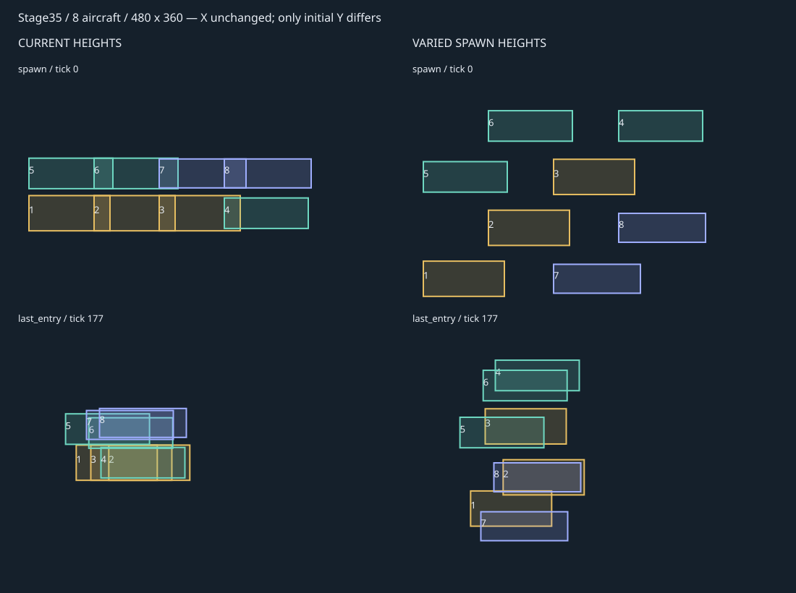
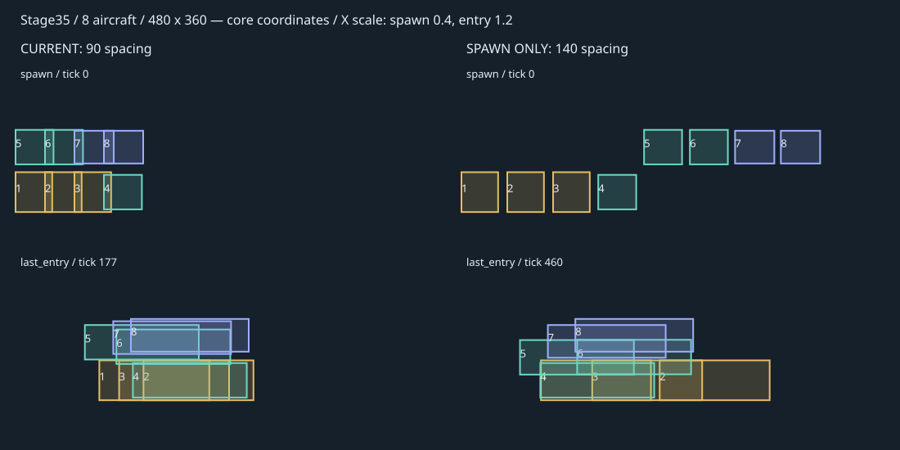

# 럭스루나에 편대 밀집 조사와 수정 계획

원작 공중 적은 맵에 저장된 개별 X·Y 좌표에서 생성된다. 럭스루나에도 생성 높이를 나누는 수정부터 검증한다. 첫 비교는 가로축만 바꿨으며, 그 결과로 진입 목적지 변경까지 필요하다고 판단한 것은 성급했다. 추가 비교에서 생성 높이만 바꿔도 진입 직후 겹침이 줄었다.

## 원작 공중 적의 생성 위치

캠페인 맵의 적 레코드는 이름 24바이트 뒤에 X·Y 실수 좌표를 가진다. X는 오프셋24, Y는28이다. `GameData.cpp`가 두 값을 읽고, `GameSession::spawnEnemy`가 `position`에 그대로 대입한다. 생성 높이를 한 값으로 통일하는 단계는 없다. 모두 화면 좌표가 아닌 월드 좌표다.

진행에 따른 생성 시점은 X로 판단한다. 원작480폭 모드에서는 플레이어가 10단위 이상 전진할 때 확인하고, 적의 배치 X가 플레이어 앞500 이내면 생성한다. 넓은 화면에서는 표시할 적을 미리 준비하지만 맵에 기록된 Y는 그대로 쓴다.

원작 자원만 읽어 현재 캠페인35개 스테이지를 집계했다. 헬기235대, 그 외 `machType=1` 공중 적21대다. 헬기의 Y는37.5~427.5이며 미션마다 여러 높이를 사용한다. 럭스루나에·VTOL 추가 함수를 호출하지 않은 집계다.

| 맵 | 기체 | X | Y |
|---|---|---:|---:|
| Stage01 | Heli001 | 211 | 145 |
| Stage01 | Heli001 | 1739 | 281 |
| Stage14 | Heli001 | 661 | 70.75 |
| Stage14 | Heli001 | 886 | 48.75 |
| Stage14 | Heli001 | 1017 | 128.75 |
| Stage14 | Boss05 | 1180 | 27.75 |
| Stage35 | Heli010 | 116 | 158 |
| Stage35 | Heli001 | 398 | 119 |
| Stage35 | Heli001 | 553 | 171 |
| Stage35 | Heli001 | 597 | 269 |
| Stage35 | Heli001 | 726 | 187 |
| Stage35 | Heli001 | 860 | 258 |

표는 X순으로 정리했다. Stage35에서 X553과597에 있는 두 헬기는 가로로44밖에 떨어져 있지 않지만, Y는98 차이가 난다. 원작은 이렇게 가로·세로 배치를 함께 사용한다. 모든 적의 일정 간격을 보장하는 편대 생성 알고리즘은 아니다.

서바이벌은 별도 규칙이다. X는 `map.right+30`, 기본 Y는 지면+1이며 헬기는 거기에200을 더한다. 지면을 찾지 못하면 기본 Y50을 사용해 헬기는250에서 생성된다. 추가 Heli001도 같은 높이 규칙을 따른다.

생성 후 공중 적의 높이는 `Enemy.cpp`에서 처리한다. 플레이어보다130 이상 높으면 하강,80보다 낮으면 상승, 그 사이면 수직 목표 속도를0으로 둔다. 이 판단은 난수 조건으로 갱신되고 실제 속도는 부드럽게 바뀐다. 생성 Y를 유지하는 고정 고도 비행은 아니다.

[원작 공중 적 전체 좌표](../evidence/original-air-spawns-20261029.csv) · [원작 자원 집계 코드](../evidence/original-air-spawns-20261029.cpp)

## 생성 높이만 바꾼 추가 비교

기존 가로 생성점·가로 목적지·속도·공중 이동 처리를 유지하고 초기 Y만 바꿨다. 지형·천장·화면 높이 안에 두 줄 또는 최대 네 줄을 배정했다. 가로로 겹치는 기체는 서로 다른 줄을 우선 사용한다. 첫 비교와 같은14개 구간×4개 화면 크기, 고정 플레이어 조건이다.

| 배치 | 생성 직후 겹친 쌍 | 마지막 기체 진입 직후 | 그 뒤5초 | 그 뒤20초 |
|---|---:|---:|---:|---:|
| 현재 처리 | 211 | 503 | 551 | 372 |
| 초기 Y만 두 줄에 분산 | 108 | 280 | 504 | 374 |
| 초기 Y만 최대 네 줄에 분산 | 33 | 137 | 527 | 374 |

수치는56조건 전체에서 회전 전 그림 사각형이 겹친 기체 쌍의 합이다. 네 줄 비교에서는 생성 직후 겹침이 남은 조건이13/56, 마지막 진입 직후에는44/56이었다. 초기 분산의 효과는 크지만, 시간이 지나면 원작 공중 AI의 높이 범위로 다시 접근한다. 다음에는 치트 앱에서 동시 진입 화면을 확인한다.



[세로 비교 요약](../evidence/lux-vertical-20261029.json) · [좌표 CSV](../evidence/lux-vertical-20261029.csv) · [재현 코드](../evidence/lux-vertical-20261029.cpp)

## 현재 코드에서 확인한 원인

| 항목 | 현재 처리 | 밀집과의 관계 |
|---|---|---|
| 생성 가로 간격 | 90. 기체 길이는 F-22 112, Su-57 116, MiG-31 120 | 같은 높이의 기체가 생성 때부터 겹친다 |
| 5~8번째 기체 | 가로 순번을 다시 0부터 쓰고 높이를 55 올린다 | 두 줄로 생성하지만 가로 위치를 재사용한다 |
| 높이 제한 | 맵 천장·카메라 높이·지형 위 높이 중 최솟값 | 공간이 낮으면 두 줄이 같은 높이로 제한될 수 있다. 이번 고정 조건에서는 이 현상을 재현하지 않았다 |
| 진입 목적지 | 기체 종류의 폭만 사용. 편대 순번 미사용 | 같은 기종끼리는 같은 X 목적지, 다른 기종도 최대 4.8 차이 |
| 진입 속도 | 갱신당 왼쪽으로 2.5 | 목적지에 도착하면 0.5로 감속. 뒤 기체가 빠르게 따라붙는다 |
| 진입 후 이동 | 원작 공중 적 AI | 플레이어보다 80~130 높은 영역으로 움직인다. 처음 높이를 나눠도 장시간 간격을 보장하지 않는다 |

핵심 코드는 `GameSession.cpp`의 `spawnReinforcements`와 `advanceAircraftEntry`다. 진입 후에는 `Enemy.cpp`의 `machType == 1` 처리를 사용한다.

90 간격으로 오는 두 기체는 약 36갱신 차이로 같은 목적지에 도착한다. 그동안 앞 기체가 속도 0.5를 유지하면 약 18만 이동한다. 140으로 늘려도 약 28이다. 실제 전투에서는 AI가 방향을 바꾸지만, 생성 간격만 늘려서는 따라붙는 구조가 남는다.

## 게임 코어 비교

실제 맵 14개와 화면 크기 4종을 사용해 안별로 56조건을 비교했다. 화면 크기는 논리 좌표 기준 480×320, 480×360, 695×320, 569×320이다. 플레이어를 해당 증원 위치의 지형 위에 고정하고 기존 생성·진입·공중 이동 함수를 실행했다. 전투·카메라 이동·렌더링은 실행하지 않았다.

표의 수치는 회전 전 기체 그림 사각형이 한 쌍 이상 겹친 조건 수다. 투명 픽셀을 제외한 실제 화면 겹침은 치트 앱에서 확인할 예정이다.

| 비교안 | 생성 직후 | 마지막 기체 진입 직후 | 그 뒤 5초 | 그 뒤 20초 |
|---|---:|---:|---:|---:|
| 현재 처리 | 56/56 | 56/56 | 55/56 | 53/56 |
| 생성 X만 140씩 벌림 | 0/56 | 56/56 | 55/56 | 53/56 |
| 생성 X와 목적지 X를 순서대로 분산 | 0/56 | 52/56 | 52/56 | 53/56 |

세 번째 안은 플레이어 앞 120부터 기존 진입 목적지 사이를 균등 분할한 비교용 배치다. 세로 배치와 진입 시차는 추가하지 않았다. 단순 가로 분산만으로는 충분하지 않았다.



그림은 Stage35의 기체 좌표와 그림 크기를 나타낸 도식이다. 왼쪽은 현재 처리, 오른쪽은 생성 간격만 140으로 늘린 경우다. 각 열의 위는 생성 순간, 아래는 마지막 기체가 진입한 순간이다.

기존 `FightersTests`는 기체를 한 대씩 끝까지 진입시켜 화면 밖 생성과 도착을 확인한다. 여러 대가 동시에 움직일 때의 간격 검사가 없어 이 문제를 잡지 못했다.

## 수정할 배치 규칙

원작 캠페인의 기체별 X·Y 배치를 참고해 증원 배치를 데이터로 지정한다. 기존 화면 밖 생성·빠른 진입·원작 공중 AI 연결은 유지한다. 별도 편대 유지나 충돌 회피 AI는 추가하지 않는다.

1. **배치 데이터:** 각 증원 구간의 기체 수에 맞춰 X·Y 배치를 정한다. 해당 맵 원작 헬기의 가로·세로 간격과 지형 위 높이를 참고한다. 원작 적 목록은 그대로 두고 추가 기체 배치만 바꾼다.
2. **생성 좌표:** 배치 전체가 화면 오른쪽 밖에 놓이도록 한 번 이동시킨다. 원작과 같은 `EnemyDefinition`의 위치값으로 생성한다. 천장·지형 때문에 배치할 수 없는 좌표는 같은 상한값으로 누르지 않고 해당 구간의 배치에서 조정한다.
3. **진입 좌표:** 기체별 가로 차이를 진입 목적지에도 반영한다. 생성 위치와 목적지를 같은 배치 데이터에서 계산해, 서로 다른 위치에서 출발한 기체들이 같은 X로 모이지 않게 한다. 생성 Y와 기존 수평 진입을 유지한다.
4. **전투:** 기존 속도로 진입한 뒤 기존 공중 적 AI에 넘긴다. 미사일·연사·내구력·총수·증원 발동 조건은 변경하지 않는다.

원작에 없던 증원 발동과 화면 밖 진입은 이미 있는 기능이다. 이번에는 그 안의 좌표 계산과 배치 데이터만 수정한다. 매 프레임 기체 간 거리를 재는 처리, 럭스루나에 전용 고도 유지, 회피·편대 AI는 만들지 않는다. 진입 시차도 현재 계획에서 추가하지 않는다.

생성점과 목적지의 배치 범위가 전장에 들어가는지 생성 시 검사한다. 기체별 높이는 원작처럼 다르게 두되, 화면 비율과 각 맵의 실제 지형에서 확인한다. 전투 중에는 기존 AI에 따라 높이가 변하고 기체가 교차할 수 있다.

## 구현과 확인 순서

세로 분산만 적용한 안과 같은 배치의 가로·세로 차이를 생성점·목적지에 함께 반영한 안을 비교한다. 기존 코어 비교에서 남은 겹침이 실제 치트 앱에서도 밀집으로 보이는지 확인해 배치 수치를 정한다.

- 배치 데이터에서 생성점·진입 목적지를 함께 계산하는 작은 함수를 두고 현재 `GameSession` 생성 경로에 연결한다. 기존 `EnemyDefinition`과 진입 상태를 사용하며, 이름별 분기나 별도 이동 시스템을 추가하지 않는다.
- 14개 증원 구간에서 2·4·6·8대가 **동시에** 진입하도록 검사한다. 생성 순간의 겹침, 진입 중 가장 좁은 간격, 모두 진입한 직후의 분포를 기록한다.
- 좁은 화면·넓은 화면·낮은 천장·높은 지형·플레이어 점프를 비교한다. 공간이 부족할 때 배치가 같은 좌표로 몰리거나 지형 안으로 내려가지 않는지 확인한다.
- iPad 치트 앱에서 8대 조건을 먼저 촬영해 한데 뭉쳐 보이는 현상이 줄었는지 확인한다. iPhone과 Apple Silicon Mac에서도 화면 폭을 달리해 확인한다.
- 진입 중 일시정지·재개, 기체 격파, 보스 선처치, 재시작·회전을 검사한다. 증원 중복, 진입 전 미사일 발사, 화면 안 갑작스러운 생성, 화면 밖 정체가 없어야 한다.
- 진입 후 20초 구간도 비교한다. 초기 배치 수정으로 남는 지속 밀집이 있다면 그 위치·시간을 제시하고, 전투 AI 변경은 별도 판단한다.

위 비교는 수정 전 조사다. 아래에 적용 결과를 기록했다.

## 조사 자료

- [코어 비교 요약](../evidence/lux-formation-20261029.json)
- [좌표 기록 CSV](../evidence/lux-formation-20261029.csv)
- [재현 코드](../evidence/lux-formation-20261029.cpp)
- [기존 기체·무장·14개 배치](../lux-lunae-plan-20261027.md)

재현 코드는 저장소 루트에서 실행한다. `HeavyMachCore`를 빌드한 뒤 다음처럼 연결한다.

```sh
clang++ -std=c++20 -ffp-contract=off -I Sources/Core \
  docs/evidence/lux-formation-20261029.cpp \
  build/lux-formation/core/libHeavyMachCore.a -o build/lux-formation/probe
build/lux-formation/probe > build/lux-formation/trace.csv
```


## X·Y 배치 적용과 기기 검사

`fix/lux-formation-xy`에서 생성 배치와 진입 목적지를 수정했다. 가로 간격은140, 세로 간격은70이다. 2·4·6·8대에 맞는 배치를 `FighterWave` 데이터에 두고, 생성점과 목적지에 같은 상대 좌표를 사용한다. 앞 기체가 먼저 감속해 뒤 기체가 따라붙던 현상을 없앴다. 화면 밖 생성, 기존 진입 속도, 진입 후 공중 적 AI, 무장·내구력·수량은 유지했다.

14개 구간 × 화면 크기5종 × 지상·점프 높이2종의140조건에서 모든 기체를 동시에 진입시켰다. 생성부터 진입 종료까지 기체 그림 사각형 사이에10 이상 여유가 있었고 지형·천장 경계를 통과했다. 코어 회귀23개와 iPhone·iPad의 기능 검사3개씩이 통과했다. 기기 검사는8대 진입·전투·일시정지,20종 무기 자동조준과 이동·점프, 키보드 조작을 포함한다. 사격 중 파일 저장은0회였다.


위 그림은 iPad 실기기의480×320 비교 캔버스에서 얻은 진입170번째 프레임이다. 다음 전체 화면 검사는 각 기기의 화면 비율을 사용한다.

수정 전과 같은56조건의 고정 플레이어 비교에서, 생성·진입 완료 시 겹친 쌍은 각각211·503에서0·0으로 줄었다. 진입5초 뒤는551에서377,20초 뒤는372에서533으로 바뀌었다. 진입 후에는 원작 AI가 플레이어 근처로 움직이므로 전투 내내 기체 간격을 유지하는 효과는 없다.

[좌표 CSV](../evidence/lux-xy-20261029.csv) · [재현 코드](../evidence/lux-xy-20261029.cpp)


### 전체 화면과 프레임 측정


두 기기 모두 iOS/iPadOS27.0.1에서 원래 타이머와 화면 출력 경로를 실행했다. 진입·전투 구간별180프레임을 측정했다. 아래 처리 시간은60Hz 제한 대기를 뺀 값이며, 호출 간격은 그 대기를 포함한 실제 시간이다.

| 기기·구간 | 처리 시간 p95 | 호출 간격 p95 | 검사 |
|---|---:|---:|---|
| iPhone Air 진입 | 9.05ms | 17.07ms | 통과 |
| iPhone Air 전투 | 9.19ms | 16.81ms | 통과 |
| iPad Air M2 진입 | 16.48ms | 21.39ms | 호출 간격 기준20ms 초과 |
| iPad Air M2 전투 | 9.21ms | 18.95ms | 통과 |

첫 iPad 측정에는 Xcode 진단 라이브러리가 붙었고 처리 시간에 표시 대기도 포함했다. 이후 진단 라이브러리를 제외하고 처리·대기 비용을 나눠 재측정했다. iPad 진입 구간의 기준 초과는 남았다. 이번 좌표 수정이 원인인지는 아직 대조하지 못했으며 렌더러·타이머 코드는 변경하지 않았다. 첫 검사 실패와 재측정 결과를 함께 보존했다.

### 무선 설치

iPhone·iPad에 치트·정식 앱을 모두 업데이트 설치하고 실행했다. 설치 전후 연결은 `localNetwork`였다. 일반 앱의 `HvM.dat`와 HUD 배치 파일은 설치 전후 바이트가 같았다. 정식 앱의 타이틀 화면도 두 기기에서 확인했다. main 병합과 버전 태그는 수행하지 않았다.

[검사·설치 기록](../evidence/lux-xy-20261029.json)
